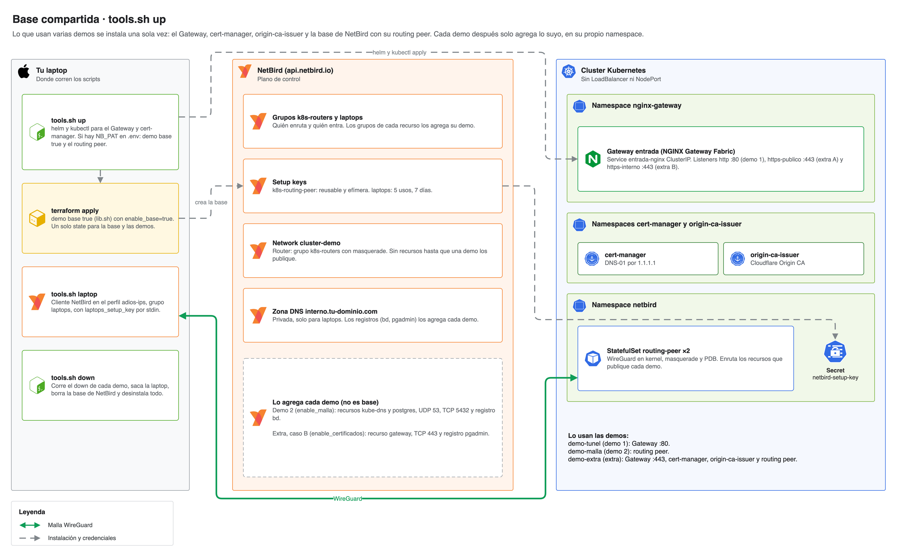
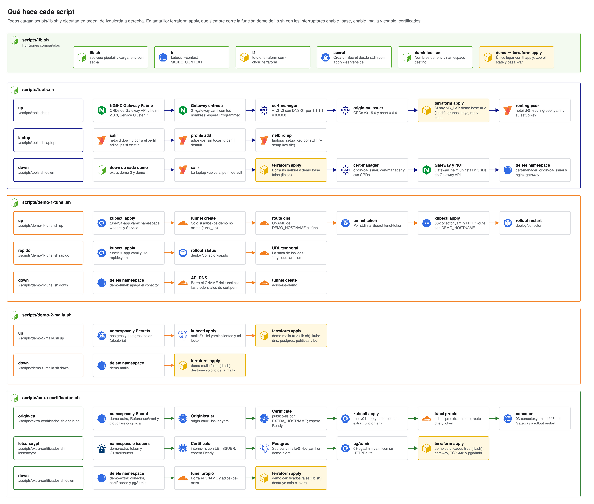
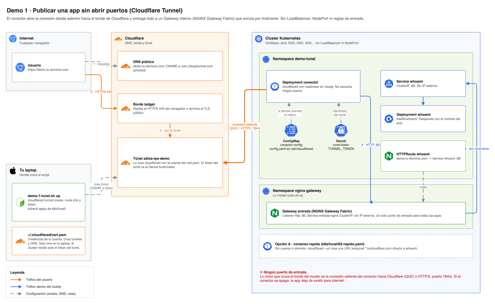
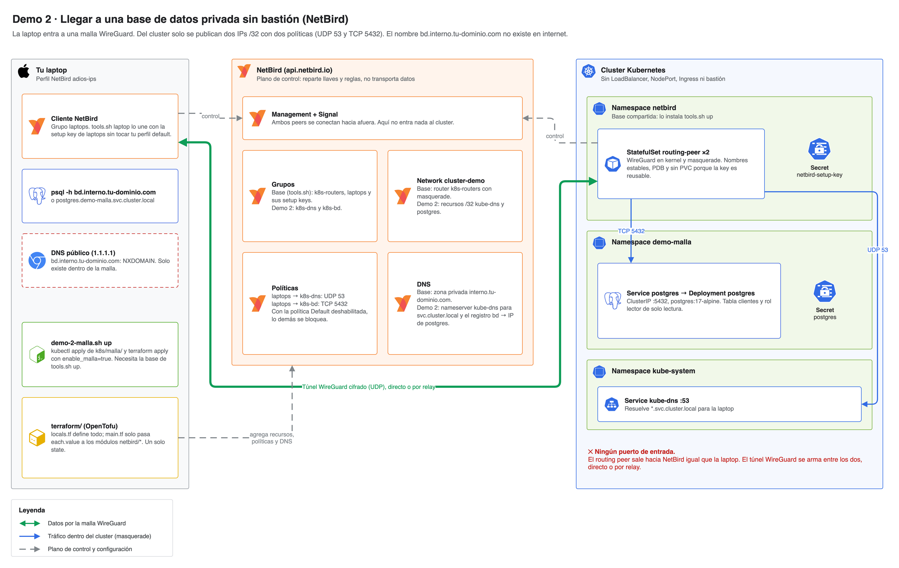
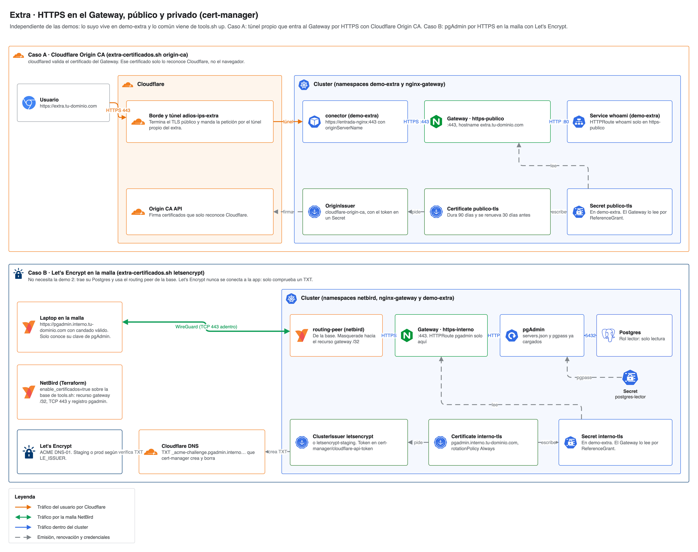

# Adiós IPs públicas · Demos

Demos de la charla **"Adiós IPs públicas: exponer servicios sin abrir un solo puerto"**.

| Demo | Qué muestra | Necesitas |
|---|---|---|
| [1 · Túnel](#demo-1--publicar-sin-abrir-puertos) | Publicar una app a internet sin IP pública y sin LoadBalancer: el túnel entra por un Gateway interno | Nada (opción A) o una cuenta de Cloudflare con un dominio (opción B) |
| [2 · Malla](#demo-2--conectar-sin-bastión) | Llegar a una base de datos privada desde tu laptop, sin bastión, solo al puerto 5432 | Una cuenta de NetBird (la gratis sirve) |
| [Extra · Certificados](#extra-opcional--https-en-el-gateway-público-y-privado) | HTTPS en el mismo Gateway: Origin CA para lo público y Let's Encrypt para pgAdmin dentro de la malla. Independiente de las demos, en su namespace `demo-extra` | Un token de Cloudflare y, para el caso B, NetBird |

Lo que comparten las demos (el Gateway, cert-manager, origin-ca-issuer y la base de NetBird con su routing peer) lo instala una sola vez [`tools.sh up`](#la-base-compartida).

Lo de afuera del cluster se crea con **`cloudflared`** (el túnel y su DNS, demo 1) y con **Terraform** (NetBird, demo 2). Lo de adentro es **YAML** que se aplica con `kubectl`.
Cada demo tiene su script en `scripts/` que hace los mismos pasos de este README, para no copiar y pegar en vivo. Puedes usar el script o seguir los pasos a mano; el resultado es el mismo.

Funciona en cualquier cluster: OrbStack, kind, minikube, EKS, AKS, GKE, k3s, RKE2.
Lo único que cambia entre clusters son las IPs de los Services de la demo 2, y abajo está cómo sacarlas.

## Un solo Gateway para todo

Todo el tráfico web entra por **un único [NGINX Gateway Fabric](https://docs.nginx.com/nginx-gateway-fabric/)** (Gateway API), el Gateway `entrada` en el namespace `nginx-gateway`. Su Service es `ClusterIP`: no tiene IP pública ni LoadBalancer.

| Listener | Puerto | Quién llega | Certificado |
|---|---|---|---|
| `http` | 80 | El túnel de Cloudflare (demo 1) | Ninguno: Cloudflare pone el HTTPS en el borde |
| `https-publico` | 443 | El túnel propio del extra (caso A) | Cloudflare Origin CA para `extra.tu-dominio.com` |
| `https-interno` | 443 | Laptops por NetBird con el caso B del extra | Let's Encrypt para `pgadmin.interno.tu-dominio.com` |

Cada app se engancha con un `HTTPRoute` por hostname. Para publicar otra, pública o privada, no hace falta otro túnel ni otro LoadBalancer: basta otro `HTTPRoute`. Si un listener HTTPS todavía no tiene su certificado, queda inválido pero los otros siguen funcionando.

La demo 2 no pasa por el Gateway: Postgres no es HTTP y la malla lo publica directo, solo TCP 5432.

## Arquitectura

Cada diagrama está en la sección que explica: [Base compartida](#la-base-compartida), [Demo 1](#demo-1--publicar-sin-abrir-puertos), [Demo 2](#demo-2--conectar-sin-bastión), [Extra](#extra-opcional--https-en-el-gateway-público-y-privado) y [Scripts](#qué-hace-cada-script). Los fuentes `.drawio` y cómo regenerar los PNG y SVG están en [docs/diagrams](docs/diagrams/README.md).

## Cómo se combinan: un dominio, dos tipos de nombre

Las dos demos usan **el mismo dominio**. Lo que cambia es quién lo resuelve y quién puede entrar:

| Nombre | Lo resuelve | Quién entra |
|---|---|---|
| `demo.tu-dominio.com` | DNS público de Cloudflare | Cualquiera en internet: es la app pública |
| `extra.tu-dominio.com` | DNS público de Cloudflare (extra, caso A) | Cualquiera en internet, con HTTPS hasta el Gateway |
| `bd.interno.tu-dominio.com` | **Zona privada de NetBird** | Solo las laptops del grupo `laptops`, y solo por TCP 5432 |
| `pgadmin.interno.tu-dominio.com` | **Zona privada de NetBird** (extra, caso B) | Solo las laptops del grupo `laptops`, y solo por TCP 443 al Gateway |

`interno.tu-dominio.com` **no existe en el DNS público**: si preguntas desde internet, no hay respuesta. Esto se llama *split-horizon DNS*: el mismo dominio responde distinto según desde dónde preguntas.

Las **políticas de NetBird** deciden qué IP y qué puerto puede tocar cada grupo. Todo lo demás queda bloqueado: si no hay política, tu laptop ni siquiera recibe la ruta.

```
.
├── .env.example                            # plantilla de credenciales; tu copia .env nunca se sube
├── docs/diagrams/                          # arquitectura: .drawio, .png y .svg
├── scripts/                                # una demo por script
│   ├── lib.sh                              # funciones comunes
│   ├── demo-1-tunel.sh                     # up | rapido | down
│   ├── demo-2-malla.sh                     # up | down
│   ├── extra-certificados.sh               # origin-ca | letsencrypt | down
│   └── tools.sh                            # up | laptop | down: la base compartida
├── k8s/                                    # manifiestos, una carpeta por demo, numerados en orden de aplicación
│   ├── gateway/                            # base: lo instala tools.sh
│   │   ├── 00-nginx-gateway-values.yaml    # values de Helm: Service ClusterIP, sin LoadBalancer
│   │   └── 01-gateway.yaml                 # Gateway entrada: listener HTTP y dos HTTPS
│   ├── netbird/                            # base: lo instala tools.sh
│   │   └── 01-routing-peer.yaml            # pods que entran a la malla y enrutan lo que publique cada demo
│   ├── tunel/                              # demo 1
│   │   ├── 01-app.yaml                     # app de ejemplo con Service ClusterIP
│   │   ├── 02-rapido.yaml                  # opción A: sin cuenta, URL temporal
│   │   └── 03-conector.yaml                # opción B: conector, su config.yaml y el HTTPRoute de la app
│   ├── malla/                              # demo 2
│   │   └── 01-bd.yaml                      # Postgres privado con Service ClusterIP y el rol lector
│   └── certificados/                       # extra: todo en el namespace demo-extra
│       ├── 00-cert-manager-values.yaml     # values de Helm para cert-manager
│       ├── 01-namespace.yaml               # demo-extra y el ReferenceGrant para que el Gateway lea sus certificados
│       ├── origin-ca/                      # caso A: túnel propio → Gateway por HTTPS con Cloudflare Origin CA
│       │   ├── 01-issuer.yaml
│       │   ├── 02-certificado.yaml         # publico-tls para el listener https-publico
│       │   └── 03-conector.yaml            # conector propio, su config.yaml al 443 del Gateway y el HTTPRoute
│       └── letsencrypt/                    # caso B: Let's Encrypt para pgAdmin dentro de la malla
│           ├── 01-issuer.yaml
│           ├── 02-certificado.yaml         # interno-tls para el listener https-interno
│           └── 03-pgadmin.yaml             # pgAdmin de solo lectura y su HTTPRoute; la base de datos se reusa de malla/
└── terraform/                              # NetBird: una sola raíz y un solo state para la base, la demo 2 y el extra
    ├── locals.tf                           # TODOS los valores, en mapas, con los IDs entre módulos
    ├── main.tf                             # un bloque module por recurso, con for_each sobre su mapa
    ├── variables.tf                        # solo declaraciones: interruptores, URL de NetBird, dominio e IPs
    ├── outputs.tf
    ├── versions.tf
    └── modules/                            # un módulo por recurso
        └── netbird/                        # group, setup-key, network, network-resource, network-router,
                                            # policy, nameserver-group, dns-zone, dns-record
```

El orden siempre es el mismo: **se crea lo de afuera (`cloudflared` o Terraform) → la credencial va a un Secret → `kubectl apply` despliega lo de adentro.**

### Por qué la demo 1 no usa Terraform

Para publicar basta `cloudflared`: `tunnel create` crea el túnel, `tunnel route dns` crea el CNAME y el ingress (a qué Service va el tráfico) vive en un ConfigMap junto al conector. No hace falta token de API: `cloudflared tunnel login` deja un certificado de tu dominio en `~/.cloudflared/cert.pem`.

Terraform entra en la demo 2, donde sí hay algo que versionar: grupos, políticas de acceso, redes y DNS privado de NetBird.

### Cómo está armado el Terraform

Hay una sola raíz en `terraform/`. Las reglas:

- **Todos los valores van en `locals.tf`**, como mapas. Cada mapa junta lo de la base y, si están encendidos, lo de la malla y lo del extra de certificados.
- **Cada recurso tiene su módulo** en `terraform/modules/`, y `main.tf` lo instancia con `for_each = local.<mapa>` y solo `each.value.<atributo>`.
- **Los módulos se encadenan en `locals.tf`:** ahí las entradas toman los IDs de los outputs de otros módulos, por ejemplo `auto_groups = [local.grupo.laptops.id]`.
- **Ningún `variables.tf` tiene valores.** Ni en la raíz ni en los módulos hay `default`: solo nombre, tipo y descripción.
- **Las variables son solo los interruptores y lo que cambia por cuenta o por cluster:** `enable_base`, `enable_malla`, `enable_certificados`, URL de NetBird, dominio interno e IPs de los Services.

```hcl
# locals.tf
locals {
  base         = var.enable_base
  malla        = var.enable_malla && local.base
  certificados = var.enable_certificados && local.base
  grupo        = module.netbird_groups

  netbird_groups = merge(
    local.base ? {
      routers = { name = "k8s-routers" }
      laptops = { name = "laptops" }
    } : {},
    local.malla ? {
      dns = { name = "k8s-dns" }
      bd  = { name = "k8s-bd" }
    } : {},
    local.certificados ? {
      gateway = { name = "k8s-gateway" }
    } : {},
  )

  netbird_setup_keys = local.base ? {
    laptops = {
      name        = "laptops"
      # ...
      auto_groups = [local.grupo.laptops.id]
    }
  } : {}
}

# main.tf
module "netbird_setup_keys" {
  source   = "./modules/netbird/setup-key"
  for_each = local.netbird_setup_keys

  name        = each.value.name
  # ...
  auto_groups = each.value.auto_groups
}
```

**Los scripts solo prenden o apagan su parte**, sin archivos `tfvars`: pasan los interruptores con `-var`. El valor de las otras partes lo sacan del state. Lo común (grupos `k8s-routers` y `laptops`, setup keys, red con su router y zona DNS) es la base: la prende `tools.sh up` y solo la apaga `tools.sh down`. Así la demo 2 y el extra se suben y bajan solos: con los dos arriba, `demo-2-malla.sh down` destruye solo los 8 recursos de la malla y el extra sigue funcionando.

Para publicar otro Service no tocas los módulos: agregas entradas a los mapas de `locals.tf`.

## Inicio rápido con los scripts

Primero saca los tokens como dice [Credenciales](#credenciales). Luego:

```bash
cp .env.example .env && chmod 600 .env   # llena tus valores; .env está en .gitignore
code .env                                # o tu editor

./scripts/tools.sh up                       # una sola vez: la base compartida
./scripts/tools.sh laptop                   # une tu laptop a la malla con el perfil de NetBird adios-ips

./scripts/demo-1-tunel.sh rapido            # opción A: sin cuenta, imprime una URL *.trycloudflare.com
./scripts/demo-1-tunel.sh up                # opción B: túnel + DNS con cloudflared, app, conector y HTTPRoute
./scripts/demo-2-malla.sh up                # Postgres y su parte de NetBird (Terraform)

./scripts/extra-certificados.sh origin-ca   # caso A: túnel propio a EXTRA_HOSTNAME, HTTPS hasta el Gateway
./scripts/extra-certificados.sh letsencrypt # caso B: pgAdmin por HTTPS dentro de la malla

./scripts/extra-certificados.sh down        # cada demo se baja sola y no toca la base
./scripts/demo-2-malla.sh down
./scripts/demo-1-tunel.sh down
./scripts/tools.sh down                     # al final: baja las demos que queden, saca tu laptop y desinstala la base
```

Cada script solo aplica sus manifiestos y prende o apaga su parte en Terraform. Si le falta algo de la base, se detiene y te dice que corras `tools.sh up`. Las pruebas están en la sección de cada demo.

### La base compartida



Sin `NB_PAT` en `.env`, `tools.sh up` instala solo lo de Kubernetes y omite NetBird: alcanza para la demo 1 y el caso A del extra. El routing peer va en su propio namespace, `netbird`, porque lo usan la demo 2 y el caso B del extra; cada una solo publica sus recursos en la red `cluster-demo`.

### Variables de `.env`

| Variable | Para qué | Ejemplo |
|---|---|---|
| `KUBE_CONTEXT` | Contexto de `kubectl` y `helm` donde corren las demos (`kubectl config get-contexts`) | `orbstack` |
| `DEMO_HOSTNAME` | Nombre público de la demo 1. Debe estar en el dominio que elegiste en `cloudflared tunnel login` | `demo.tu-dominio.com` |
| `NB_PAT` | Access token de NetBird (empieza por `nbp_`). El provider lo lee solo de esta variable | |
| `INTERNAL_DOMAIN` | Zona DNS privada de NetBird. No se crea nada en Cloudflare | `interno.tu-dominio.com` |
| `POSTGRES_PASSWORD` | Contraseña del usuario `app` de Postgres | |
| `CERT_MANAGER_CLOUDFLARE_TOKEN` | Solo para el extra. Token de Cloudflare que queda dentro del cluster: *DNS Edit* y *SSL and Certificates Edit* | |
| `LE_ISSUER` | Caso B: `letsencrypt-staging` para probar, `letsencrypt` para el certificado válido | `letsencrypt-staging` |
| `PGADMIN_PASSWORD` | Caso B: la única clave que conoce quien entra a pgAdmin (usuario `lector@adios-ips.com`) | |
| `EXTRA_HOSTNAME` | Opcional. Nombre público del caso A. Sin ella se usa `extra.` + el dominio de `DEMO_HOSTNAME` | `extra.tu-dominio.com` |
| `AUTO_APPROVE` | `1` = `terraform apply` sin pedir confirmación | `0` |
| `NB_MANAGEMENT_URL` | Opcional. URL de NetBird self-hosted. Sin ella se usa `https://api.netbird.io` | |
| `TUNNEL_ORIGIN_CERT` | Opcional. Otro `cert.pem` de `cloudflared` en vez de `~/.cloudflared/cert.pem` | |

`lib.sh` carga el `.env` con `set -a`: lo que esté ahí gana sobre lo que tengas exportado en la terminal.

### Qué hace cada script



El diagrama muestra cada subcomando paso por paso. Lo que no se ve en él:

**Dónde corre Terraform.** Ningún script llama a `terraform` directo: los pasos en amarillo son la función `demo` de `lib.sh`, y esa función hace el `terraform apply`. Cada script solo dice qué parte prende o apaga; la otra la lee del state y la respeta.

```bash
demo base true           # tools.sh up                       → terraform apply -var enable_base=true ...
demo base false          # tools.sh down                     → terraform apply -var enable_base=false ...
demo malla true          # demo-2-malla.sh up                → terraform apply -var enable_malla=true ...
demo malla false         # demo-2-malla.sh down              → terraform apply -var enable_malla=false ...
demo certificados true   # extra-certificados.sh letsencrypt → ... -var enable_certificados=true ...
demo certificados false  # extra-certificados.sh down        → ... -var enable_certificados=false ...
```

**Orden y dependencias.**

- `tools.sh up` va primero: todo lo que usan dos o más demos vive ahí.
- Las demos y el extra son independientes entre sí: cada uno tiene su namespace (`demo-tunel`, `demo-malla`, `demo-extra`) y su propio túnel. El extra reusa los YAML de la app y de Postgres, aplicados en `demo-extra` con la función `en` de `lib.sh`.
- El `down` de cada demo no toca la base. `tools.sh down` corre el `down` de las tres, saca tu laptop y desinstala la base.

**Se pueden repetir.** Todos los `up` son idempotentes: el túnel se crea solo si no existe, el CNAME se sobrescribe, la clave de `postgres-lector` se genera solo la primera vez y `demo` no corre Terraform si su parte ya está como se pide.

**Por qué algunos pasos son así.**

- `k` fija `--context $KUBE_CONTEXT`: ningún comando toca otro cluster.
- `secret` recibe el valor por stdin y usa `apply --server-side`: el valor no pasa por argumentos ni queda en la anotación `last-applied-configuration`.
- `dominios` cambia `demo.tu-dominio.com` y `pgadmin.interno.tu-dominio.com` por `DEMO_HOSTNAME` y `pgadmin.$INTERNAL_DOMAIN` antes de cada `apply`.
- `demo-1-tunel.sh down` borra primero el namespace, porque no se puede borrar un túnel con conexiones. El CNAME lo borra con la API de Cloudflare y las credenciales de `cert.pem`, porque `cloudflared` no lo hace.
- `tools.sh laptop` crea un perfil de NetBird nuevo (`adios-ips`): un peer ya registrado ignora una setup key nueva, y así no tocas tus otros perfiles. Para volver al tuyo: `netbird profile select <perfil> && netbird up`.
- Prueba Let's Encrypt con `LE_ISSUER=letsencrypt-staging`: producción permite 5 certificados iguales por semana, y cada `letsencrypt` después de un `down` pide uno nuevo.

## Antes de empezar

- `kubectl` apuntando al cluster donde vas a probar. Revisa el contexto antes de aplicar nada:

  ```bash
  kubectl config current-context
  ```

  Si tienes varios clusters, agrega `--context <nombre>` a cada comando. Por ejemplo, en OrbStack: `--context orbstack`.

- [Terraform](https://developer.hashicorp.com/terraform/install) 1.6+ o [OpenTofu](https://opentofu.org/docs/intro/install/) para la demo 2 y el extra. Donde dice `terraform`, `tofu` funciona igual.
- [`cloudflared`](https://developers.cloudflare.com/cloudflare-one/connections/connect-networks/downloads/) en tu laptop para la demo 1, opción B (`brew install cloudflared`), y `jq`.
- El cluster solo necesita **salida a internet**. No hace falta abrir ningún puerto de entrada.

## Credenciales

**Nunca van en archivos del repo.** Con los scripts van en tu `.env`, que está en `.gitignore`. A mano se cargan como variables de entorno en la terminal.

### Login de cloudflared (demo 1, opción B)

La demo 1 no usa token de API. Una sola vez:

```bash
cloudflared tunnel login   # abre el navegador: elige tu dominio y autoriza
```

Deja `~/.cloudflared/cert.pem` (permisos 600). Con él, `cloudflared` crea túneles y registros DNS en ese dominio. Trátalo como un secreto: no lo copies al repo ni al cluster.

### Access token de NetBird (demo 2)

Lo recomendado es un **service user**, para que el token no dependa de tu usuario personal:

1. Entra a [app.netbird.io](https://app.netbird.io) → **Team → Service Users → Create Service User**. Nombre `terraform`, rol **Admin**.
2. Abre el service user → **Create Access Token**. Nombre `adios-ips-demo` y una expiración corta, por ejemplo 30 días.
3. Cópialo. Empieza por `nbp_` y NetBird lo muestra **una sola vez**.

> Para una prueba rápida también sirve un token de tu propio usuario: **Team → Users →** tu usuario **→ Create Access Token**.

### Cargarlos en la terminal (pasos a mano)

Si usas los scripts, salta esto: pon los tokens en `.env`.

`read -rs` lee el valor sin mostrarlo en pantalla y sin que quede en el historial. Funciona en zsh y en bash:

```bash
read -rs NB_PAT && export NB_PAT   # pega el token de NetBird y Enter
```

El provider de NetBird lo lee solo de esa variable. Al cerrar la terminal desaparecen.

## Secretos

Este repo **no trae ningún secreto**. Los YAML solo apuntan por nombre a Secrets que tú creas en el cluster:

| Secret | Namespace | Llave | De dónde sale | Lo usa |
|---|---|---|---|---|
| `tunel-token` | `demo-tunel` | `token` | `cloudflared tunnel token adios-ips-demo` | `k8s/tunel/03-conector.yaml` |
| `netbird-setup-key` | `netbird` | `key` | `terraform output -raw routers_setup_key` | `k8s/netbird/01-routing-peer.yaml` |
| `postgres` | `demo-malla` | `password` | Tú la eliges | `k8s/malla/01-bd.yaml` |
| `postgres-lector` | `demo-malla` y `demo-extra` | `password` | Aleatoria (`openssl rand`), nadie la ve | `01-bd.yaml` y pgAdmin |
| `pgadmin` | `demo-extra` | `password` | Tú la eliges (`PGADMIN_PASSWORD`) | Extra, caso B |
| `cloudflare-origin-ca` | `demo-extra` | `api-token` | [Token de cert-manager](#token-de-cloudflare-para-cert-manager) | Extra, caso A |
| `cloudflare-api-token` | `cert-manager` | `api-token` | [Token de cert-manager](#token-de-cloudflare-para-cert-manager) | Extra, caso B |

Los que vienen de Terraform pasan **directo del output al cluster** por stdin, sin verse en pantalla ni en los argumentos del proceso:

```bash
terraform output -raw <output> | kubectl -n <namespace> create secret generic <secret> --from-file=<llave>=/dev/stdin
```

Reglas:

- No pegues tokens ni keys directamente en un comando: quedan en `~/.zsh_history` o `~/.bash_history`.
- **El `terraform.tfstate` guarda las setup keys en texto plano.** Está en `.gitignore`. Si trabajas en equipo, usa un backend remoto cifrado (S3, GCS, Azure Storage o Terraform Cloud).
- El `.gitignore` también bloquea `.env` (menos `.env.example`), `*secret*.yaml`, `*.token`, `*.key` y `*.pem`, por si acaso.
- Si clonas el repo en otra máquina, crea un `.env` nuevo; no lo copies por chat ni lo subas a otro lado.
- Si algo se filtra, revócalo: el token de API en el panel del proveedor; el túnel y las setup keys con `terraform apply -replace=<recurso>` (la dirección exacta sale de `terraform state list`). Luego recrea el Secret.
- Para cambiar un Secret: `kubectl -n <namespace> delete secret <secret>`, créalo de nuevo y reinicia el workload con `kubectl -n <namespace> rollout restart ...`.

---

## Demo 1 · Publicar sin abrir puertos



Necesitas el Gateway: `./scripts/tools.sh up` (ver [`tools.sh`](#qué-hace-cada-script)). El túnel no apunta a la app sino al Gateway, y el Gateway la elige por hostname.

### Paso 1 · La app

```bash
kubectl apply -f k8s/tunel/01-app.yaml
kubectl -n demo-tunel rollout status deploy/whoami
```

Comprueba que no hay nada expuesto. Solo debe salir un Service `ClusterIP`:

```bash
kubectl -n demo-tunel get svc
```

### Paso 2 · El túnel

Elige **una** de las dos opciones.

#### Opción A · Túnel rápido (sin cuenta, sin Terraform)

Ideal para probar en local. La URL es aleatoria y cambia cada vez que el pod se reinicia. `./scripts/demo-1-tunel.sh rapido` hace estos pasos y te imprime la URL.

```bash
kubectl apply -f k8s/tunel/02-rapido.yaml
kubectl -n demo-tunel rollout status deploy/conector-rapido
```

Busca la URL pública en los logs. Puede tardar unos 10 segundos en aparecer:

```bash
kubectl -n demo-tunel logs deploy/conector-rapido | grep trycloudflare.com
```

#### Opción B · Tu dominio, con cloudflared

Necesitas haber hecho el [login de cloudflared](#login-de-cloudflared-demo-1-opción-b) una vez.

1. Crea el túnel y el registro DNS que apunta a él:

   ```bash
   cloudflared tunnel create adios-ips-demo
   cloudflared tunnel route dns adios-ips-demo demo.tu-dominio.com
   ```

2. Pasa el token del túnel a un Secret y despliega el conector:

   ```bash
   cloudflared tunnel token adios-ips-demo | kubectl -n demo-tunel create secret generic tunel-token --from-file=token=/dev/stdin
   kubectl apply -f k8s/tunel/03-conector.yaml   # antes cambia demo.tu-dominio.com por tu hostname
   kubectl -n demo-tunel rollout status deploy/conector
   ```

   A dónde va el tráfico lo dice el `config.yaml` del ConfigMap `conector-config`, en el mismo YAML:

   ```yaml
   ingress:
     - hostname: demo.tu-dominio.com
       service: http://entrada-nginx.nginx-gateway.svc.cluster.local:80
     - service: http_status:404
   ```

   Tu hostname va al Gateway; cualquier otro nombre que llegue al túnel recibe `404`. El mismo YAML trae el `HTTPRoute` `whoami`, que le dice al Gateway que `demo.tu-dominio.com` es el Service `whoami`. Para publicar otra app por el mismo túnel agregas su CNAME, una regla `hostname` igual y su `HTTPRoute`. El caso A del extra cambia la regla al puerto 443 del Gateway con `originServerName`.

   Ese archivo no queda en tu máquina. Vive en el ConfigMap, dentro del cluster. Kubernetes lo monta en solo lectura en `/etc/cloudflared/config.yaml` dentro del contenedor, y `cloudflared` lo lee al arrancar (`--config`). Por eso, si cambias el ConfigMap, hay que reiniciar el conector con `kubectl -n demo-tunel rollout restart deploy/conector`. No tiene nada secreto: la identidad del túnel va aparte, en el Secret `tunel-token`.

   El conector tiene una `readinessProbe` en `/ready`: el pod está listo solo cuando tiene conexiones activas con el borde. Para alta disponibilidad en producción basta subir `replicas`: el túnel acepta varios conectores y el borde usa cualquiera que esté conectado.

   `create` también deja un `~/.cloudflared/<id>.json`, pero no hace falta: el conector usa el token.

En el panel de Cloudflare (**Zero Trust → Networks → Tunnels**) el túnel debe aparecer **Healthy**.

### Paso 3 · La prueba

```bash
curl -sI https://<tu-url>        # HTTP/2 200
curl -s  https://<tu-url>        # responde "Hostname: whoami-..."
kubectl get svc -A | grep -E "LoadBalancer|NodePort"   # vacío: nada expuesto
kubectl -n nginx-gateway logs deploy/entrada-nginx --tail=3   # la petición pasó por el Gateway
```

### Limpiar

```bash
kubectl delete namespace demo-tunel                # primero el conector: no se borra un túnel con conexiones
cloudflared tunnel delete -f adios-ips-demo        # solo si usaste la opción B
```

`cloudflared` no borra el CNAME: bórralo en el panel (**DNS → Records**). `./scripts/demo-1-tunel.sh down` lo hace solo.

---

## Demo 2 · Conectar sin bastión



Necesitas el [token de NetBird](#access-token-de-netbird-demo-2) cargado en `NB_PAT`. Con los scripts, la base de NetBird, el routing peer y tu laptop vienen de `tools.sh up` y `tools.sh laptop`; a mano son los pasos 3 a 5 con `enable_base=true`.

### Paso 1 · La base de datos

Crea el namespace y una contraseña que tú elijas. Guárdala, la usas en la prueba:

```bash
kubectl create namespace demo-malla
read -rs VALOR            # escribe la contraseña y Enter (no se ve nada, es normal)
printf %s "$VALOR" | kubectl -n demo-malla create secret generic postgres --from-file=password=/dev/stdin
unset VALOR

kubectl apply -f k8s/malla/01-bd.yaml
kubectl -n demo-malla rollout status deploy/postgres
```

### Paso 2 · Las IPs del cluster

Terraform necesita la IP de los dos Services que vas a publicar en la malla. Funciona igual en cualquier cluster:

```bash
kubectl -n kube-system get svc kube-dns -o jsonpath='{.spec.clusterIP}'; echo
kubectl -n demo-malla  get svc postgres -o jsonpath='{.spec.clusterIP}'; echo
```

> Se publican **dos IPs sueltas, no todo el rango de Services**. Lo que no está en Terraform no existe para la laptop.

### Paso 3 · NetBird con Terraform

```bash
cd terraform
terraform init
terraform apply \
  -var enable_base=true -var enable_malla=true -var enable_certificados=false \
  -var management_url=https://api.netbird.io -var internal_domain=interno.tu-dominio.com \
  -var kube_dns_ip=<ip-de-kube-dns> -var postgres_ip=<ip-de-postgres> -var gateway_ip=
```

Los valores de la demo están en `locals.tf`; por `-var` solo van los interruptores y lo que depende de tu cuenta y tu cluster. Repite estos mismos `-var` en cada `terraform apply`.

`internal_domain` puede ser un subdominio de tu dominio público, por ejemplo `interno.tu-dominio.com`. No tienes que crear nada en Cloudflare: esa zona vive solo en NetBird.

Esto crea:

| Recurso | Parte | Para qué |
|---|---|---|
| Grupos `k8s-routers` y `laptops` | Base | Quién enruta y quién entra |
| Setup key `k8s-routing-peer` | Base | Reusable y ephemeral: cada pod se registra al arrancar y NetBird borra solo los que mueren |
| Setup key `laptops` | Base | Para unir tu laptop directo al grupo con acceso |
| Network `cluster-demo` | Base | Routing peer = el **grupo** `k8s-routers`, con masquerade |
| Zona DNS `interno.tu-dominio.com` | Base | Zona privada de NetBird. Solo la reciben las `laptops` |
| Grupos `k8s-dns` y `k8s-bd` | Malla | Qué se alcanza. Un grupo por recurso |
| Recursos `kube-dns` y `postgres` | Malla | Dos `/32` en `cluster-demo` |
| Policy `laptops-dns-cluster` | Malla | `laptops` → `k8s-dns`, solo **UDP 53** |
| Policy `laptops-bd` | Malla | `laptops` → `k8s-bd`, solo **TCP 5432** |
| Nameserver `kube-dns` | Malla | Resuelve `*.svc.cluster.local` con el DNS del cluster, solo para `laptops` |
| Registro `bd` | Malla | `bd.interno.tu-dominio.com` → IP de Postgres |

> Toda cuenta nueva de NetBird trae una policy **Default** que deja hablar a todos con todos. Terraform no la toca. Desactívala en **Access Control → Policies → Default**: si no, las dos políticas de arriba no sirven de nada.

### Paso 4 · El routing peer (base)

Va en su propio namespace, `netbird`, porque también lo usa el caso B del extra. Pasa la setup key a un Secret y despliega:

```bash
cd ..
kubectl apply -f k8s/netbird/01-routing-peer.yaml
terraform -chdir=terraform output -raw routers_setup_key | kubectl -n netbird create secret generic netbird-setup-key --from-file=key=/dev/stdin
kubectl -n netbird rollout status statefulset/routing-peer
kubectl -n netbird exec routing-peer-0 -- netbird status
```

Debes ver `Management: Connected` y `Interface type: Kernel`. En el panel aparecen `routing-peer-0` y `routing-peer-1` en el grupo `k8s-routers`.

Por qué el routing peer es así:

- **StatefulSet y no Deployment:** los pods se llaman igual tras cada reinicio (`routing-peer-0`, `routing-peer-1`), así el panel no se llena de peers nuevos. `NB_HOSTNAME` toma el nombre del pod.
- **2 réplicas en el mismo grupo:** la red se enruta por grupo, no por peer. Si un pod cae, el otro toma la ruta. `podAntiAffinity` las reparte entre nodos y el PodDisruptionBudget evita que un drain saque las dos.
- **`NET_ADMIN` y `/dev/net/tun`:** WireGuard corre en el kernel. Sin eso cae a userspace y el masquerade falla.
- **Sin PVC:** la setup key es reusable y efímera. El pod se registra de nuevo al arrancar y NetBird borra solo los peers que ya no existen.
- **NetBird self-hosted:** agrega al contenedor la variable `NB_MANAGEMENT_URL` con tu URL.

### Paso 5 · Tu laptop (base)

Instala el cliente desde [netbird.io/download](https://netbird.io/download) y únete con la setup key de laptops en un perfil propio, así no tocas otra sesión de NetBird (por ejemplo la del trabajo). La key entra por stdin:

```bash
netbird profile add adios-ips
terraform -chdir=terraform output -raw laptops_setup_key |
  netbird up --profile adios-ips --management-url https://api.netbird.io --setup-key-file /dev/stdin
```

Para volver a tu perfil: `netbird down && netbird profile select default && netbird up`.

> Alternativa sin key: `netbird up` con login SSO, y en el panel agregas tu laptop al grupo `laptops`.

### Paso 6 · La prueba

```bash
netbird networks list                               # aparecen kube-dns y postgres
nc -vz bd.interno.tu-dominio.com 5432               # nombre de la zona privada: conexión OK
nc -vz postgres.demo-malla.svc.cluster.local 5432   # nombre del cluster, vía kube-dns: también OK
psql -h bd.interno.tu-dominio.com -U app -d app -c "select * from clientes;"   # pide la contraseña del paso 1
```

**Solo ese puerto:** la política abre TCP 5432 hacia la IP de Postgres y nada más. Cualquier otra IP del cluster, como la del Gateway, no tiene ruta:

```bash
nc -vz -w 3 <ip-de-entrada-nginx> 80   # timeout: no está publicada en la malla
```

La base trae una tabla `clientes` y un rol `lector` de solo lectura (`default_transaction_read_only` y solo `SELECT`). Su clave es aleatoria y vive en el Secret `postgres-lector`: ninguna persona la necesita. La usa pgAdmin en el [caso B del extra](#caso-b--pgadmin-con-lets-encrypt-dentro-de-la-malla-demo-2).

**El nombre interno no existe en internet:**

```bash
dig +short bd.interno.tu-dominio.com             # en tu laptop, con NetBird: la IP de Postgres
dig +short @1.1.1.1 bd.interno.tu-dominio.com    # DNS público: vacío
```

**Las políticas mandan:** desactiva `laptops-bd` en **Access Control → Policies** y espera unos segundos:

```bash
netbird networks list   # postgres desaparece: sin política, NetBird ni siquiera te da la ruta
```

Vuelve a dejarla como estaba con `terraform apply`. Terraform detecta el cambio hecho a mano y lo revierte.

¿No tienes `psql`? En macOS: `brew install libpq` y usa `$(brew --prefix libpq)/bin/psql`.

> **Ojo en OrbStack:** tu Mac ya llega a las IPs del cluster sin pasar por la malla, así que con la política apagada `nc` igual conecta por el bridge de OrbStack. Para ver que la prueba va de verdad por la malla:
> - **macOS:** corre `route -n get <ip-del-service-postgres>`. La interfaz debe ser `utun…` (NetBird), no `bridge…`.
> - **Otro equipo:** prueba desde otro dispositivo de tu cuenta NetBird, por ejemplo tu celular o un segundo laptop.
>
> En un cluster en la nube (EKS, AKS, GKE) esto no pasa: sin la malla, simplemente no llegas.

**Prueba de alta disponibilidad:** borra el routing peer que tiene la ruta y mira cómo la toma el otro:

```bash
kubectl -n netbird delete pod routing-peer-0
netbird status -d | grep -B3 "Networks: "          # ahora la ruta la tiene routing-peer-1
nc -vz bd.interno.tu-dominio.com 5432              # sigue conectando
```

El peer viejo queda un rato en el panel como desconectado; al ser ephemeral, NetBird lo borra solo.

### Limpiar

```bash
kubectl delete namespace demo-malla
cd terraform && terraform apply -var enable_malla=false ...   # los demás -var como en el paso 3; la base y el extra siguen
```

La base (routing peer, laptop y su parte de NetBird) la quita `./scripts/tools.sh down`. A mano: `kubectl delete namespace netbird`, `terraform apply -var enable_base=false ...` y `netbird down`; los peers ephemeral del cluster desaparecen solos y tu laptop la borras en **Peers**.

---

## Extra opcional · HTTPS en el Gateway, público y privado

**No lo necesitas para la demo 1.** Con el proxy de Cloudflare activo el navegador ya ve un certificado válido, y en la malla todo viaja cifrado por WireGuard. Pero el navegador no sabe de WireGuard: una web interna por `http://` sale como **"No seguro"**. Este extra pone HTTPS en los dos listeners del Gateway.



Hay dos casos y dos CAs distintas:

| | Caso A · Cloudflare Origin CA | Caso B · Let's Encrypt |
|---|---|---|
| Listener | `https-publico` | `https-interno` |
| Qué cifra | El tramo **túnel → Gateway** de la demo 1 | **Laptop → pgAdmin** dentro de la malla |
| Quién firma | Cloudflare, con una CA privada suya | Let's Encrypt, una CA pública |
| Quién confía en el certificado | Solo Cloudflare. **El navegador no** | Cualquier navegador |
| Cómo prueba que el dominio es tuyo | Con tu token de API de Cloudflare | Reto **DNS-01**: crea un TXT en Cloudflare. **No abre ningún puerto** |
| Renovación | cert-manager + `origin-ca-issuer`, solo | cert-manager, solo |

En el caso B Cloudflare **no firma nada**: solo guarda tu DNS. cert-manager usa el token para escribir un TXT temporal, Let's Encrypt lo lee y firma. Por eso sirve para nombres que **no existen en internet**, como `pgadmin.interno.tu-dominio.com`: nunca se conecta a la app.

¿Por qué no Origin CA también para pgAdmin? Porque ahí el navegador habla directo con el Gateway, sin pasar por Cloudflare, y no confía en Origin CA.

**El extra no depende de las demos.** Usa lo común de `tools.sh up` (Gateway, cert-manager, origin-ca-issuer y, en el caso B, la base de NetBird con su routing peer) y todo lo suyo vive en el namespace `demo-extra`: su túnel `adios-ips-extra` con su conector y su `whoami` (caso A), y su Postgres y pgAdmin (caso B). Los certificados también están ahí; el `ReferenceGrant` de `01-namespace.yaml` deja que el Gateway los lea. Cuando cert-manager los renueva, NGINX Gateway Fabric ve el Secret nuevo y recarga solo.

### Token de Cloudflare para cert-manager

Este token **vive dentro del cluster** todo el tiempo, porque cert-manager lo usa en cada renovación. Por eso lleva lo mínimo y **sin** permisos de túnel. Con los scripts va en `CERT_MANAGER_CLOUDFLARE_TOKEN` de tu `.env`.

1. Entra a [dash.cloudflare.com](https://dash.cloudflare.com) → ícono de perfil → **My Profile → API Tokens → Create Token → Create Custom Token**.
2. Nombre `cert-manager` y estos permisos:

   | Tipo | Recurso | Permiso | Para qué |
   |---|---|---|---|
   | Zone | DNS | Edit | Caso B: crear y borrar el TXT del reto |
   | Zone | SSL and Certificates | Edit | Caso A: pedir certificados de Origin CA |

   Si solo vas a usar un caso, quita el permiso del otro.
3. **Zone Resources:** *Specific zone* → tu dominio. Opcional: ponle fecha de expiración.
4. **Continue to summary → Create Token** y cópialo. Cloudflare lo muestra **una sola vez**.

### Las herramientas

`./scripts/tools.sh up` instala cert-manager y origin-ca-issuer junto con el Gateway. A mano:

```bash
helm install cert-manager oci://quay.io/jetstack/charts/cert-manager --version v1.21.2 \
  -n cert-manager --create-namespace -f k8s/certificados/00-cert-manager-values.yaml --wait

kubectl apply \
  -f https://raw.githubusercontent.com/cloudflare/origin-ca-issuer/v0.15.0/deploy/crds/cert-manager.k8s.cloudflare.com_clusteroriginissuers.yaml \
  -f https://raw.githubusercontent.com/cloudflare/origin-ca-issuer/v0.15.0/deploy/crds/cert-manager.k8s.cloudflare.com_originissuers.yaml
helm install origin-ca-issuer oci://ghcr.io/cloudflare/origin-ca-issuer-charts/origin-ca-issuer --version 0.6.9 \
  -n origin-ca-issuer --create-namespace --wait
```

`cert-manager-values.yaml` le dice a cert-manager que verifique el TXT con resolvers públicos. Sin eso, en varios clusters (OrbStack, por ejemplo) el reto se queda en `SERVFAIL` preguntándole a `kube-dns`.

### Caso A · Cloudflare Origin CA

Un túnel propio para `extra.tu-dominio.com` que entra al Gateway por el 443. En los YAML cambia `extra.tu-dominio.com` por tu nombre.

1. El namespace, el token y el emisor:

   ```bash
   kubectl apply -f k8s/certificados/01-namespace.yaml
   read -rs VALOR            # pega el token de cert-manager y Enter
   printf %s "$VALOR" | kubectl -n demo-extra create secret generic cloudflare-origin-ca --from-file=api-token=/dev/stdin
   unset VALOR
   kubectl apply -f k8s/certificados/origin-ca/01-issuer.yaml
   ```

2. El certificado. Dura 90 días y cert-manager lo renueva 30 días antes:

   ```bash
   kubectl apply -f k8s/certificados/origin-ca/02-certificado.yaml
   kubectl -n demo-extra wait certificate/publico-tls --for=condition=Ready --timeout=180s
   ```

3. La app, el túnel y el conector:

   ```bash
   sed 's/demo-tunel/demo-extra/' k8s/tunel/01-app.yaml | kubectl apply -f -
   cloudflared tunnel create adios-ips-extra
   cloudflared tunnel route dns adios-ips-extra extra.tu-dominio.com
   cloudflared tunnel token adios-ips-extra | kubectl -n demo-extra create secret generic tunel-token --from-file=token=/dev/stdin
   kubectl apply -f k8s/certificados/origin-ca/03-conector.yaml
   ```

   Su `config.yaml` apunta al 443 del Gateway:

   ```yaml
   ingress:
     - hostname: extra.tu-dominio.com
       service: https://entrada-nginx.nginx-gateway.svc.cluster.local:443
       originRequest:
         originServerName: extra.tu-dominio.com
     - service: http_status:404
   ```

   `originServerName` hace que `cloudflared` pida ese nombre por SNI y **valide** el certificado contra él. Si el certificado no es de Cloudflare o no cubre el nombre, responde `502`. El `HTTPRoute` se engancha solo al listener `https-publico`.

4. Prueba: `curl -s https://extra.tu-dominio.com | grep X-Forwarded-Proto` dice `https`: el Gateway recibió la petición por el 443. En **SSL/TLS → Origin Server** del panel aparece el certificado emitido.

### Caso B · pgAdmin con Let's Encrypt dentro de la malla

pgAdmin con su propia Postgres, en `demo-extra`. No necesita la demo 2: le basta la base de NetBird (pasos 3 a 5 de la demo 2 con solo `enable_base=true`, o `tools.sh up` y `tools.sh laptop`). En los YAML cambia `pgadmin.interno.tu-dominio.com` por tu nombre.

**Quien entra solo conoce la clave de pgAdmin.** pgAdmin arranca con el servidor ya cargado (`servers.json`) y se conecta como `lector` con un `pgpass` que escribe un initContainer desde el Secret `postgres-lector`. La clave de la base no aparece en la UI, solo hay acceso de lectura y solo se ve la base `app` (`DBRestriction`). No se usa `PasswordExecCommand` porque desde la UI permitiría correr comandos en el pod.

1. El token y los emisores (staging y producción):

   ```bash
   kubectl apply -f k8s/certificados/01-namespace.yaml
   read -rs VALOR            # pega el token de cert-manager y Enter
   printf %s "$VALOR" | kubectl -n cert-manager create secret generic cloudflare-api-token --from-file=api-token=/dev/stdin
   unset VALOR
   kubectl apply -f k8s/certificados/letsencrypt/01-issuer.yaml
   ```

2. El certificado. Arranca con **staging** (`issuerRef.name: letsencrypt-staging`) para no chocar con los límites de Let's Encrypt:

   ```bash
   kubectl apply -f k8s/certificados/letsencrypt/02-certificado.yaml
   kubectl -n demo-extra wait certificate/interno-tls --for=condition=Ready --timeout=300s
   ```

   El reto DNS-01 tarda uno o dos minutos; lo ves con `kubectl -n demo-extra get challenge`. El nombre debe estar dentro de `internal_domain`.

3. Los Secrets, la base y pgAdmin. La base es la misma de la demo 2, en otro namespace:

   ```bash
   read -rs VALOR && printf %s "$VALOR" | kubectl -n demo-extra create secret generic postgres --from-file=password=/dev/stdin
   openssl rand -hex 24 | tr -d '\n' | kubectl -n demo-extra create secret generic postgres-lector --from-file=password=/dev/stdin
   read -rs VALOR && printf %s "$VALOR" | kubectl -n demo-extra create secret generic pgadmin --from-file=password=/dev/stdin
   unset VALOR
   sed 's/demo-malla/demo-extra/' k8s/malla/01-bd.yaml | kubectl apply -f -
   kubectl apply -f k8s/certificados/letsencrypt/03-pgadmin.yaml
   ```

4. NetBird con Terraform: recurso `gateway` `/32`, política solo TCP 443 y registro `pgadmin`. El routing peer de la base lo enruta:

   ```bash
   (cd terraform && terraform apply -var enable_base=true -var enable_certificados=true -var gateway_ip=<ip-de-entrada-nginx> ...)   # enable_malla según la demo 2
   ```

   `gateway_ip` sale de `kubectl -n nginx-gateway get svc entrada-nginx -o jsonpath='{.spec.clusterIP}'`.

5. Con tu laptop en la malla ([paso 5 de la demo 2](#paso-5--tu-laptop-base) o `./scripts/tools.sh laptop`), prueba:

   ```bash
   curl -sk https://pgadmin.interno.tu-dominio.com/misc/ping   # con staging: -k, el certificado no es de confianza
   dig +short @1.1.1.1 pgadmin.interno.tu-dominio.com          # vacío: no existe en internet
   ```

   Abre `https://pgadmin.interno.tu-dominio.com`, entra como `lector@adios-ips.com` con tu clave y abre **app (solo lectura)**: no pide otra clave. En el Query Tool `select * from clientes;` funciona, y un `insert` falla con `cannot execute INSERT in a read-only transaction`.

6. Pasa a producción: cambia `issuerRef.name` a `letsencrypt` en `02-certificado.yaml` y vuelve a aplicarlo. Con el certificado válido el navegador muestra el candado.

**Probar la renovación automática** con [`cmctl`](https://cert-manager.io/docs/reference/cmctl/) (`brew install cmctl`). Fuerza una renovación igual a la que cert-manager hace solo antes de que venza; el Gateway la toma sin reiniciar nada:

```bash
cmctl -n demo-extra renew interno-tls
echo | openssl s_client -connect pgadmin.interno.tu-dominio.com:443 -servername pgadmin.interno.tu-dominio.com 2>/dev/null | openssl x509 -noout -serial   # serial nuevo
```

### Limpiar el extra

`./scripts/extra-certificados.sh down` hace esto; `./scripts/tools.sh down` además desinstala las herramientas. A mano:

```bash
kubectl delete namespace demo-extra                  # primero el conector: no se borra un túnel con conexiones
cloudflared tunnel delete -f adios-ips-extra         # y borra el CNAME extra.tu-dominio.com en el panel
(cd terraform && terraform apply -var enable_certificados=false ...)   # enable_malla según la demo 2
```

---

## Si algo falla

| Síntoma | Causa probable |
|---|---|
| `terraform apply` da `401` o `403` | El token no está cargado en esta terminal (`echo ${#NB_PAT}` debe dar más de 0) o le faltan permisos. |
| `cloudflared tunnel route dns` dice que el registro ya existe | Ya hay un registro con ese hostname que no es de este túnel. Usa otro, bórralo en el panel o agrega `--overwrite-dns`. |
| `cloudflared tunnel delete` dice que hay conexiones activas | Aún corre el conector. Borra primero el namespace `demo-tunel`, o usa `-f`. |
| El túnel rápido no muestra URL | El cluster no tiene salida a internet por 443 o 7844. Revisa `kubectl -n demo-tunel logs deploy/conector-rapido`. |
| El túnel con token responde `502` o `1033` | El Gateway no está (`./scripts/tools.sh up`), el Service no se llama `whoami` en `demo-tunel`, o el conector no está corriendo (`kubectl -n demo-tunel get pods`). |
| Un pod en `CreateContainerConfigError` | Falta su Secret o la llave tiene otro nombre. Revisa la tabla de [Secretos](#secretos) y `kubectl -n <namespace> describe pod <pod>`. |
| `routing-peer` en `CrashLoopBackOff` | Falta el Secret `netbird-setup-key` en `netbird`, o la key expiró. Renuévala con `terraform apply -replace='module.netbird_setup_keys["routers"].netbird_setup_key.this'` y recrea el Secret (o corre `./scripts/tools.sh up`). |
| `Interface type: Userspace` | El nodo no tiene `/dev/net/tun`. En plataformas sin `NET_ADMIN` (Fargate, Cloud Run, Container Apps) el routing peer va en una VM chica al lado. |
| `netbird networks list` no muestra `postgres` | Tu laptop no está en el grupo `laptops`, o la policy `laptops-bd` está deshabilitada. Sin política no hay ruta. |
| Resuelve el nombre pero no conecta | La IP del Service cambió (se borró y recreó). Actualiza `postgres_ip` y corre `terraform apply`. |
| Conecta a 5432 pero no a otro puerto | Es lo esperado: la política solo abre TCP 5432. |
| No resuelve `bd.interno...` | Tu laptop no está en `laptops`, o arrancaste NetBird con `--disable-dns`. |
| No resuelve `*.svc.cluster.local` | El `kube_dns_ip` está mal, o falta la política `laptops-dns-cluster`. |
| Extra: el reto DNS-01 dice `SERVFAIL` | cert-manager está preguntando a `kube-dns`. Instálalo con `cert-manager-values.yaml`. |
| Extra: `Cloudflare API Error code=1016 ... not authorized` | Al token de cert-manager le falta *SSL and Certificates: Edit* (caso A) o *DNS: Edit* (caso B). |
| Extra: el caso A da `502` | El certificado aún no está listo, o los `dnsNames` no incluyen el hostname. Revisa `kubectl -n demo-extra get certificate`. |
| La demo 1 da `404` | El hostname del `config.yaml` o del `HTTPRoute` no es el tuyo. Revisa `kubectl -n demo-tunel get httproute` y `kubectl -n demo-tunel get cm conector-config -o yaml`. |
| Un listener sale `InvalidCertificateRef` | Su certificado aún no existe (normal hasta correr su caso del extra), o falta el `ReferenceGrant` de `01-namespace.yaml`. Los otros listeners funcionan igual. |
| pgAdmin dice `Connection lost` o pide clave | El `pgpass` solo cubre la base `app`. Revisa que `servers.json` tenga `DBRestriction` y reinicia: `kubectl -n demo-extra rollout restart deploy/pgadmin`. |
| Extra: el certificado sigue fallando después de arreglar el token | cert-manager espera cada vez más entre intentos. Fuerza uno nuevo con `cmctl -n <namespace> renew <certificate>`. |
| Corriste `terraform destroy` y se borraron la base, la demo 2 y el extra | Es un solo state: `destroy` borra todo. Para apagar una demo pon su `enable_*` en `false` y corre `terraform apply`, o usa el `down` de su script. |
| Un script dice `falta la base de NetBird` | Pon `NB_PAT` en `.env` y corre `./scripts/tools.sh up`: instala la base de NetBird y el routing peer. |
| La laptop se une pero no recibe redes | Ese peer ya estaba registrado y NetBird ignoró la setup key nueva. Únete con un perfil nuevo (`./scripts/tools.sh laptop` lo hace solo) o borra el peer en **Peers** y vuelve a unirte. |
| `netbird status` dice `Nameservers: 0/1` | El chequeo se hizo antes de que la ruta estuviera lista. `netbird down && netbird up` lo refresca. |
